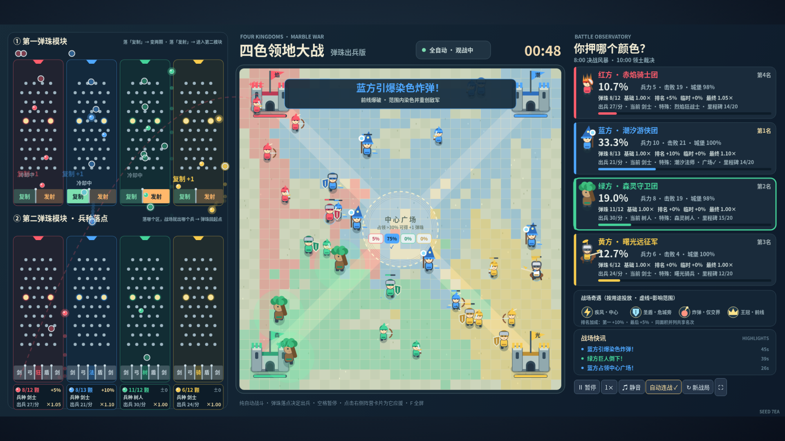
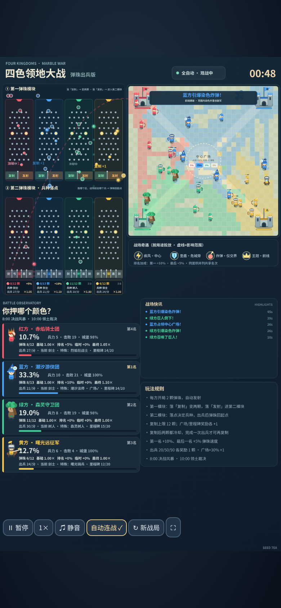

# 四色领地大战 Four-Color Territory War · 弹珠出兵版

红、蓝、绿、黄四方全自动对战的 2D 网页小游戏。浏览器打开即可观看，无需安装。

在线观看：https://birdfry.github.io/four-color-war/

- 左侧弹珠、右侧战场（手机竖屏也保持左右分栏）。
- 每方开局 2 颗弹珠。第一模块落「复制」变两颗，落「发射」进入第二模块；第二模块的落点决定战场上出什么兵，出兵后弹珠回到起点。
- 复制上限 12 颗；复制后原球和新球都进入冷却，各自完成一次第二模块出兵后才能再复制。
- 奖励弹珠：中心广场占领 >30% +1 颗（每局一次）；累计出兵 20/50/90 各 +1 颗；每颗奖励同时把上限 +1。
- 8:00 开启决战风暴，10:00 领土裁决。
- 领地第一名弹珠速度 +10%，最后一名 +5%；面积相同则并列共享名次，全部并列时都不加成。
- 特殊兵种：红·烈焰狂战士（溅射）、蓝·潮汐法师（远程减速）、绿·森灵树人（治疗光环）、黄·曙光骑兵（攻城扩地）。
- 炸弹只在不同颜色领地交界处出现；加速在中心，圣盾在危急城堡附近，王冠在前线。

